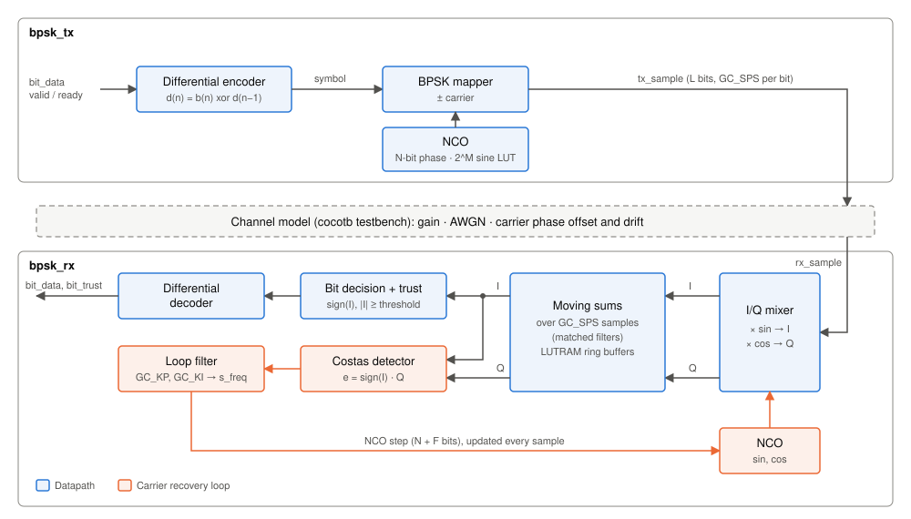
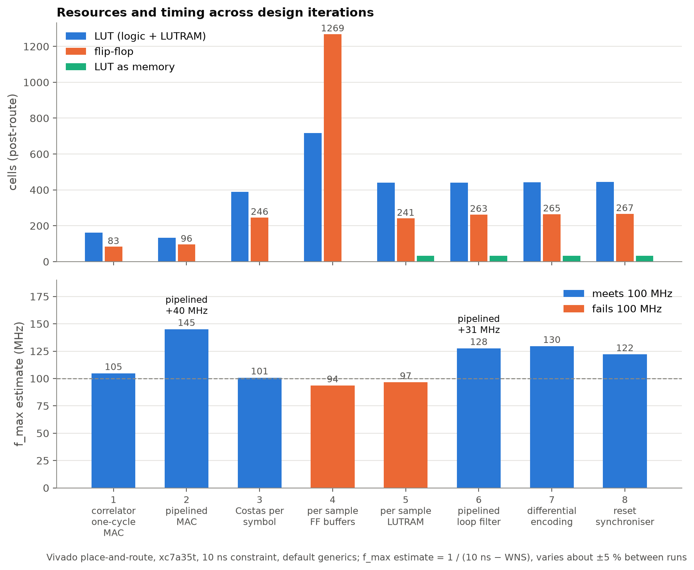
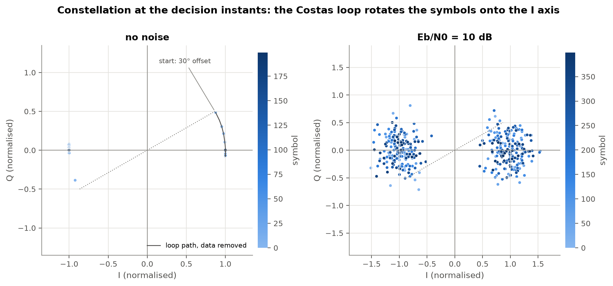
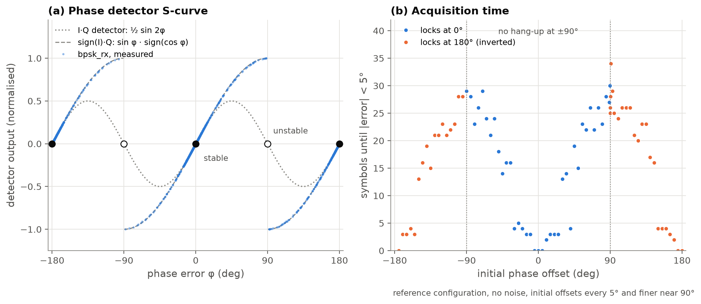
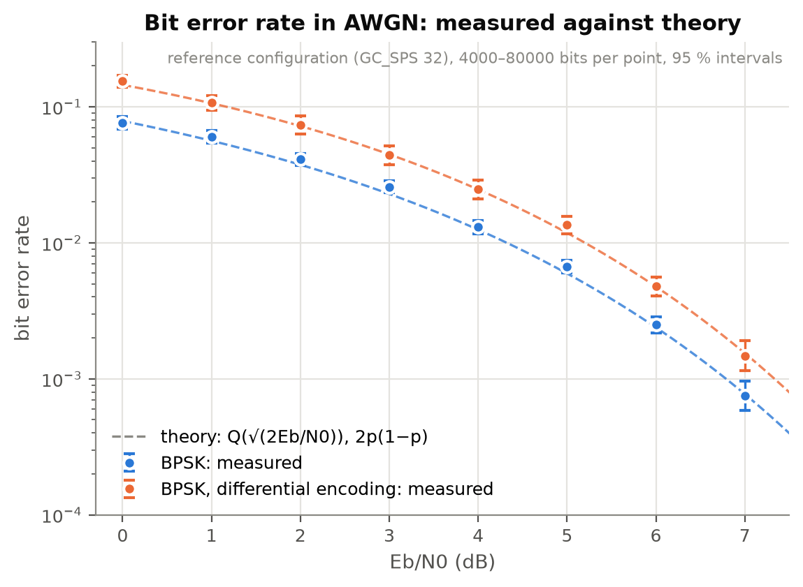
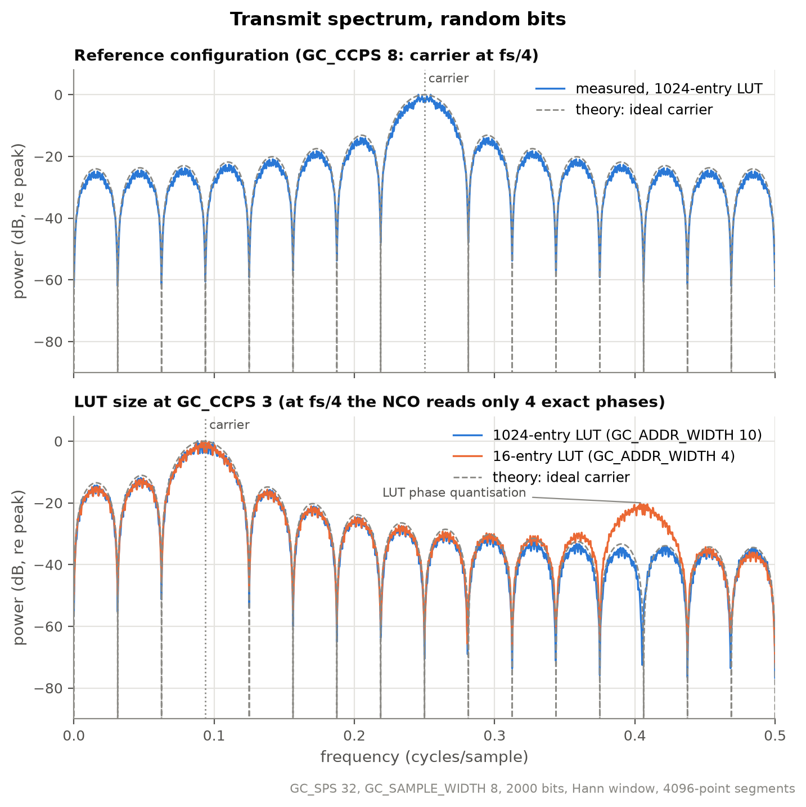

# BPSK modem on FPGA with Costas-loop carrier recovery

A parameterisable BPSK transmitter and receiver in VHDL-2008. The receiver recovers the carrier phase with a
per-sample Costas loop and resolves the 180° ambiguity with differential encoding. Synthesised and
placed-and-routed for an Artix-7 (xc7a35t), verified in simulation with UVVM
testbenches and cocotb system tests.

## Results

| | Result |
|---|---|
| **Footprint** | 444 LUT (2.1 %), 267 FF (0.6 %), 4 DSP48, 1 BRAM; post-route, xc7a35t |
| **Timing** | meets the 100 MHz constraint, WNS +1.8 ns (f_max estimate ≈ 120 MHz); register-to-register only |
| **Optimisation** | ring buffers moved to LUTRAM: −81 % flip-flops; two pipelining steps: +40 MHz and +31 MHz |
| **Link** | BER within 0.25 dB of theory for BER 10⁻¹ to 10⁻³; carrier acquisition from any phase in ≤ 34 symbols |
| **Throughput** | f_clk / GC_SPS: 3.125 Mbit/s at 100 MHz, latency GC_SPS + 7 clocks (reference configuration) |

Reference configuration: 8-bit samples, 24-bit NCO phase, 1024-entry sine LUT, 32 samples per symbol, carrier at
fs/4, differential encoding on.

## Architecture



## FPGA implementation



Every design iteration:

| # | Problem | Change | Result |
|---|---|---|---|
| 1 | Baseline: coherent correlator, carrier phase known | Multiply, accumulate and decide in one clock | 105 MHz; 14 logic levels |
| 2 | Iteration 1 limited by its 14-level MAC path | Product registered before the accumulate | 145 MHz, −19 % LUT |
| 3 | Receiver assumed the carrier phase | Costas loop updated once per symbol, fraction bits in the loop filter | 101 MHz |
| 4 | Correlation only valid at the symbol end | Moving-sum matched filters, loop updated every sample | 1269 FF; 94 MHz, misses 100 MHz |
| 5 | Ring buffers with reset: 2 × 32 × 16 bits in flip-flops | Ring buffers without reset map to LUTRAM; a window-full flag replaces the reset | 241 FF (−81 %); 97 MHz, misses 100 MHz |
| 6 | Loop filter in one clock: 23 logic levels, 18 CARRY4 | Split into error, integral and step stages | 128 MHz |
| 7 | A 180° lock inverts every bit | Differential encoding | +3 LUT, +2 FF; 130 MHz |
| 8 | Reset released asynchronously | Reset synchroniser | +2 FF; 122 MHz (run-to-run variation) |

The critical path is now the ring-buffer read into the DSP48 accumulator, 3 logic levels. Resources grow slowly
with the oversampling ratio, since the LUTRAM depth absorbs it: 8 → 128 samples per symbol costs +28 % LUT.

## Clocking, reset and interfaces

- **One clock domain**, no clock-domain crossings. `clk_en` paces the tx samples and `sample_valid` the rx input.
- **Reset:** `reset_n`, active low, asserted asynchronously and released synchronously through a 2-flip-flop
  synchroniser. tx and rx share it and leave reset on the same edge, which the
  rx symbol timing relies on.
- **Not reset, by design:** the LUTRAM ring buffers and the sample delay lines; a reset would prevent LUTRAM and SRL
  inference.
- **Interfaces:** bits in with valid/ready; samples out and in with valid only (no backpressure); bits out with a
  valid pulse and a trust flag.

## Carrier recovery





The detector e = sign(I)·Q (a) keeps full restoring force next to the unstable point at ±90°, where the classic
I·Q Costas detector has none, so the loop acquires from any initial phase without hang-up (b, noiseless). Offsets
beyond ±90° lock at 180°, which inverts every symbol; differential encoding removes that.

### Loop design

| | Configuration |
|---|---|
| **Loop** | Loop filter and NCO, updated every sample |
| **Detector** | e = sign(I)·Q on GC_SPS-sample moving sums; gain K_d = A_r·A·GC_SPS/2, ¾ of that on random data |
| **Gains** | shifts, GC_KP = 2L + 2·log₂(GC_SPS) − N + 1 and GC_KI = GC_KP + 4 + log₂(GC_SPS); fraction bits below the step LSB |
| **Delay** | 8 registers in the loop plus the moving-sum window: 0.73 symbols at GC_SPS = 32 |
| **Frequency range** | s_freq saturates at ±1/8 of the carrier step (GC_FREQ_LIMIT) |

## Link performance



Measured bit error rate in AWGN against theory, with 95 % intervals. The channel model adds Gaussian noise to every
sample, scaled so that Eb/N0 is per bit at the matched-filter output. Over the tested range (BER 10⁻¹ to 10⁻³)
both modes stay within 0.25 dB of theory. Differential encoding costs a factor of two: one wrong symbol decision
corrupts two decoded bits, BER = 2p(1 − p). The symbol error rate is the same in both modes, with no 180° cycle
slips (80 000 symbols each at 2 dB).

## Transmitter



The measured spectrum matches that of ideal BPSK with rectangular pulses; there is no pulse shaping, so the sidelobes
are at −13 dB. At the fs/4 carrier the NCO reads only four exact phases; at other carriers a 16-entry sine LUT adds
a spur, hence the 1024-entry LUT.

## Verification

| Level | Framework | Checks |
|---|---|---|
| tx, rx, modem, reset synchroniser | UVVM, scoreboards, BFMs | bit-exact samples, latency, handshake, reset at every position, input gaps, 180° inversion |
| tx → channel → rx | cocotb | BER within binomial bounds, phase offset and drift, 180° ambiguity |

The reference models are independent of the RTL. One configuration file drives both frameworks.

## Limitations and roadmap

- Symbol timing is not recovered: tx and rx must be reset together. Next: timing recovery.
- The loop gain scales with the input amplitude, so the loop slows down on weak signals. Next: AGC.
- Planned: phase lock detector, forward error correction (Viterbi, K = 3, rate 1/2), NCO phase dithering,
  root-raised-cosine pulse shaping.

## Reproduce

```bash
make sim-all                                   # UVVM, every configuration
make cocotb                                    # cocotb system tests
make synth impl                                # Vivado, xc7a35tcpg236-1
```

The figures come from separate report simulations and plotting scripts, which are not part of this repository.

---

Tools: Vivado 2026.1 (synthesis, place-and-route), GHDL 4.1.0, UVVM, cocotb 2.1.0.

The cocotb testbenches, the make scripts and the figure tooling were written by Claude Opus 5.5 (Anthropic), which
was also used in part for writing the documentation.
